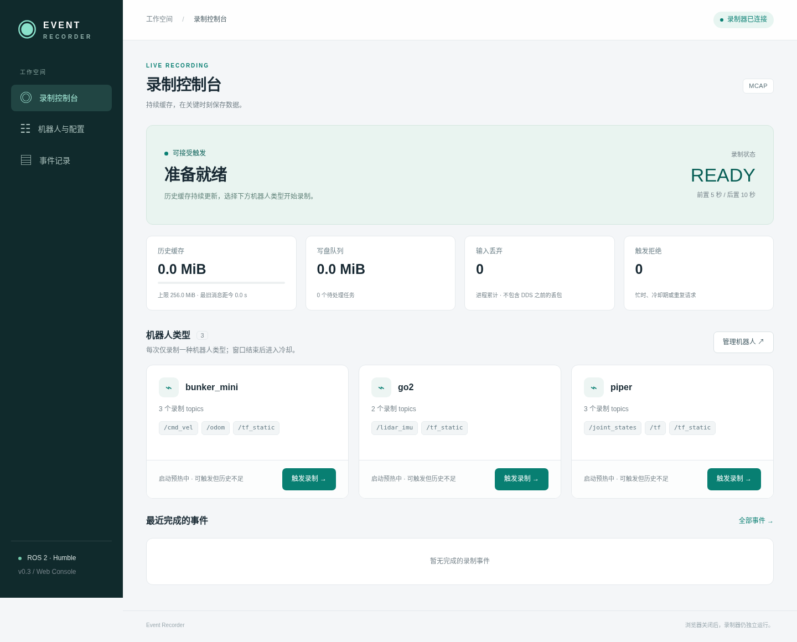

# ROS 2 Event Recorder

**English** | [简体中文](README.zh-CN.md)

Record what happened **before and after an event**. The recorder continuously buffers ROS 2 topics in memory and writes a replayable rosbag when triggered—from the Web UI, a ROS service/topic, or an external detector.

Default behavior: **5 seconds before + 10 seconds after**, an **8-second history buffer**, and a **3-second cooldown** after each capture window. Only one event can be active or finalizing at a time.

- Robot profiles: `go2`, `bunker_mini`, and `piper`, each with configurable topics.
- MCAP and SQLite3 storage, static TF context, and per-event completeness metadata.
- Lightweight Web UI for configuration, triggering, status, and event history. No Node.js, frontend build, or database required.
- Included example: trigger `bunker_mini` after cumulative odometry travel exceeds 20 m.

## Quick start

**Requirements:** Ubuntu 22.04, ROS 2 Humble, `colcon`, and an initialized `rosdep`. The recorder uses C++17; the Web UI uses Python 3 and the ROS environment. Custom message types must be installed on the recording machine.

```bash
source /opt/ros/humble/setup.bash

git clone https://github.com/JINGERGER/event_recorder.git
cd event_recorder
rosdep install --from-paths src --ignore-src --rosdistro humble -r -y
colcon build --packages-select event_recorder
source install/setup.bash

ros2 launch event_recorder gui.launch.py
```

Open **http://127.0.0.1:8080**. The launch starts both the recorder and the Web UI. On first use, it copies the example configuration to `recorder.local.yaml` in the current directory; subsequent launches keep your changes.

The example configuration uses MCAP. Its plugin is declared as a package dependency; it can also be installed explicitly:

```bash
sudo apt install ros-humble-rosbag2-storage-mcap
```

For each new terminal, source ROS and this workspace's `install/setup.bash` before running project commands.

## Web UI



The UI currently uses Chinese labels and provides three pages:

| Page | Purpose |
| --- | --- |
| Recording console | Trigger a robot profile; view capture/cooldown state, buffer usage, queue size, and drop counts. |
| Robots & configuration | Register topics and types, select QoS, edit robot profiles, and set time windows and resource budgets. |
| Event history | Inspect the latest 100 events, completion status, errors, message counts, and bag paths. |

**Saving configuration does not change the running recorder.** Finish the current event, stop the launch with Ctrl+C, and launch it again to apply changes. The UI distinguishes saved settings from the running configuration.

Closing the browser does not stop recording. Stopping the entire launch stops both processes. To choose another configuration or port:

```bash
ros2 launch event_recorder gui.launch.py config:=/path/to/recorder.yaml port:=8081
```

For access from a laptop to an Orin or another remote host, keep the default localhost binding and forward the port:

```bash
ssh -L 8080:127.0.0.1:8080 user@robot-host
```

Open localhost:8080 on the laptop. Direct LAN access and attaching the UI to an existing recorder are covered in the [reference guide](docs/reference.md).

## Configure robot profiles

Robot names identify **recording profiles**, not ROS topics or automatic robot detection. The default mappings are:

| Profile | Example recorded topics |
| --- | --- |
| `go2` | `/lidar_imu`, `/tf_static` |
| `bunker_mini` | `/odom`, `/cmd_vel`, `/tf_static` |
| `piper` | `/joint_states`, `/tf`, `/tf_static` |

Edit them in the UI or in `recorder.local.yaml`. The [example YAML](src/event_recorder/config/recorder.yaml) shows the full format: register topic names/types/QoS first, then select topics under `triggers.<robot_type>.topics`. Include context topics such as `/tf_static` explicitly in each profile that needs them.

These are editable examples, not complete robot-driver integrations. Verify names, message types, and QoS against your actual drivers. If multiple robots publish simultaneously, use appropriate topic namespaces; profile names alone do not separate same-named topics.

## Trigger a recording

Use a UI button, or publish `std_msgs/msg/String` to `/event_recorder/trigger`:

```bash
ros2 topic pub --once /event_recorder/trigger std_msgs/msg/String \
  "{data: 'go2|alarm-001|robot anomaly'}"
```

The `data` format is `robot_type|request_id|reason`:

| Field | Meaning |
| --- | --- |
| `robot_type` | Selects a configured profile, such as `go2`. |
| `request_id` | Identifies this request. Accepted IDs are deduplicated within the same profile for 60 seconds by default. |
| `reason` | Saved in the event metadata for traceability. |

Publishing only the profile name, such as `data: 'piper'`, sends an anonymous request without ID deduplication. For an explicit acceptance/rejection response, use the profile's service:

```bash
ros2 service call /event_recorder/triggers/go2 std_srvs/srv/Trigger '{}'
```

New triggers are **rejected while capturing, during cooldown, or while the previous event is still being written**. They are not deferred, merged, or used to extend the window. For example, a trigger accepted at T=100 captures [95,110]; the next trigger can be accepted at T=113 at the earliest, provided writing has finished.

## Example: Bunker Mini travels 20 m

The example detector sums successive `/odom` XY position increments and sends one `bunker_mini` trigger when cumulative travel first exceeds 20 m. This is **path length**, not straight-line distance from the start.

In two terminals sourced with the ROS/workspace environment, run:

**Terminal 1 — recorder, Web UI, and detector:**

```bash
export ROS_DOMAIN_ID=90 ROS_LOCALHOST_ONLY=1
ros2 launch event_recorder bunker_distance_demo.launch.py port:=8081
```

**Terminal 2 — replay the source bag after the demo is ready:**

```bash
export ROS_DOMAIN_ID=90 ROS_LOCALHOST_ONLY=1
ros2 bag play /path/to/rosbag2_2025_12_24-21_12_52 \
  --rate 4 --delay 2 --disable-keyboard-controls \
  --topics /odom /imu/data_raw /scan /tf /tf_static
```

Open **http://127.0.0.1:8081**. The source bag is not included in this repository. With the validated bag, the trigger occurs at **20.001397 m**, about **207 seconds at normal speed** or **52 seconds at 4× speed**. The recorder's window remains 15 seconds of reception time, so accelerated replay covers a longer interval of source data.

See the [complete example guide](docs/bunker-distance-demo.en.md) for reset commands, detector parameters, and verification results.

## Output and operating limits

Each event produces a bag directory and a neighboring metadata file:

```text
event_bags/
├── <event_id>/             # rosbag2 files and metadata.yaml
└── <event_id>.event.yaml   # trigger, selected topics, counts, completeness, errors
```

`COMPLETED` means writing finished without detected local incompleteness. `PARTIAL` means known missing/truncated data; `FAILED` means an error prevented successful recording. A leftover `CAPTURING` state is not a completed event.

```bash
EVENT_ID=your_event_id
ros2 bag info "event_bags/$EVENT_ID"
ros2 bag play "event_bags/$EVENT_ID"
```

Windows use **monotonic reception time**; bag timestamps use ROS reception time. History resides in RAM and is not crash-persistent. Payload memory is roughly `input rate × history duration`: 100 MiB/s for 8 seconds needs about 800 MiB before other overhead, exceeding the default 256 MiB history budget. Adjust budgets and measure on the deployment hardware.

## Documentation and validation

| Document | Contents |
| --- | --- |
| [Reference guide](docs/reference.md) | Parameters, ROS/HTTP APIs, remote access, recording semantics, and test commands. |
| [Bunker Mini example](docs/bunker-distance-demo.en.md) | Complete 20 m trigger walkthrough. |
| [Validation record](VALIDATION.md) · Chinese | Recorded test results and their limits. |
| [Performance measurements](PERFORMANCE.md) · Chinese | Historical v0.1 CPU/RAM measurements; not a benchmark of the current version. |
| [Machine-readable reports](reports/) | Acceptance, GUI, performance, and real-bag test evidence. |

Builds and tests were run on Ubuntu 22.04 / ROS 2 Humble, including real ROS transport, MCAP/SQLite3 checks, and Chrome GUI tests. AGX Orin deployment has not yet been validated. The [original design](ros2_data_recorder_design.md) is historical; its trigger-merging policy is superseded by the single-event behavior described here.

## License

[Apache License 2.0](LICENSE).
