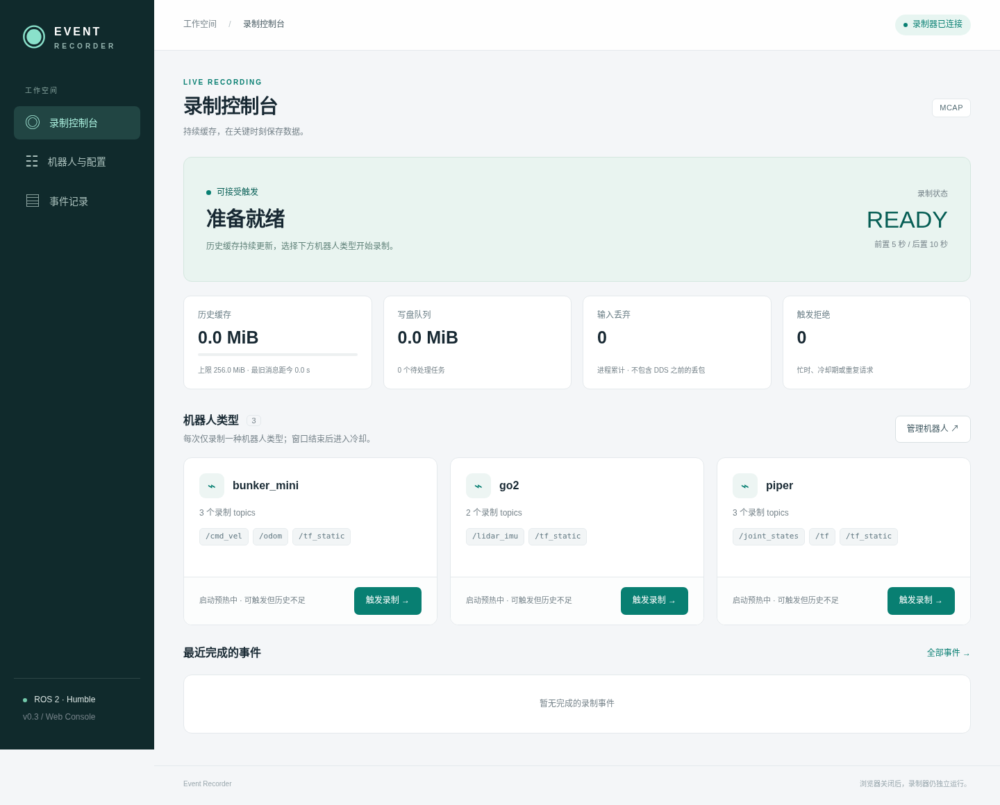

# ROS 2 事件录制器

[English](README.md) | **简体中文**

保存**事件发生前后**的 ROS 2 数据。录制器持续在内存中缓存 topic，收到来自 Web GUI、ROS 服务/topic 或外部判断节点的触发后，生成可回放的 rosbag。

默认行为：**前 5 秒 + 后 10 秒**、**8 秒历史缓存**、录制窗口结束后**冷却 3 秒**。全局同一时间只允许一个正在采集或写盘的事件。

- 按机器人类型管理录制配置：`go2`、`bunker_mini`、`piper`，各自选择需要录制的 topic。
- 支持 MCAP、SQLite3、静态 TF 上下文和事件完整性元数据。
- 轻量 Web GUI 提供配置、触发、状态与事件查看，无需 Node.js、前端构建或数据库。
- 内置示例：Bunker Mini 的里程计累计行驶超过 20 米时自动触发。

## 快速开始

**环境要求：** Ubuntu 22.04、ROS 2 Humble、`colcon` 和已初始化的 `rosdep`。录制核心使用 C++17，Web GUI 使用 Python 3 和 ROS 环境。录制自定义消息时，需要在运行设备上安装对应消息类型支持。

```bash
source /opt/ros/humble/setup.bash

git clone https://github.com/JINGERGER/event_recorder.git
cd event_recorder
rosdep install --from-paths src --ignore-src --rosdistro humble -r -y
colcon build --packages-select event_recorder
source install/setup.bash

ros2 launch event_recorder gui.launch.py
```

浏览器打开 **http://127.0.0.1:8080**。该命令同时启动录制器和 Web GUI。首次运行会将示例配置复制为当前目录下的 `recorder.local.yaml`，后续启动保留你修改过的内容。

示例配置使用 MCAP，插件已列入包依赖；也可以单独安装：

```bash
sudo apt install ros-humble-rosbag2-storage-mcap
```

每个新终端运行项目命令前，都需要 source ROS 环境和本工作空间的 `install/setup.bash`。

## Web GUI



界面目前使用中文，包含三个页面：

| 页面 | 功能 |
| --- | --- |
| 录制控制台 | 按机器人类型触发；查看录制/冷却状态、缓存用量、写盘队列和丢弃计数。 |
| 机器人与配置 | 注册 topic 和消息类型、选择 QoS、编辑机器人配置、设置时间窗口与资源预算。 |
| 事件记录 | 查看最近 100 个事件的完成状态、错误、消息数和 bag 路径。 |

**保存配置不会修改正在运行的录制器。** 等当前事件完成后，在启动终端按 Ctrl+C，再运行相同启动命令使配置生效。页面会区分已保存的配置和正在使用的配置。

关闭浏览器不会停止录制；停止整个 launch 会关闭录制器和 Web 服务。可以指定配置文件和端口：

```bash
ros2 launch event_recorder gui.launch.py config:=/path/to/recorder.yaml port:=8081
```

从笔记本访问 Orin 或其他远程设备时，可以保持默认的本机监听方式，通过 SSH 转发端口：

```bash
ssh -L 8080:127.0.0.1:8080 user@robot-host
```

随后在笔记本打开 localhost:8080。直接局域网访问、连接已有录制器等操作见[参考文档](docs/reference.zh-CN.md)。

## 配置机器人类型

机器人名称表示**一组录制配置**，不是 ROS topic，也不会自动识别机器人。默认映射如下：

| 机器人类型 | 示例录制 topic |
| --- | --- |
| `go2` | `/lidar_imu`、`/tf_static` |
| `bunker_mini` | `/odom`、`/cmd_vel`、`/tf_static` |
| `piper` | `/joint_states`、`/tf`、`/tf_static` |

可以在 GUI 或 `recorder.local.yaml` 中修改。[完整示例 YAML](src/event_recorder/config/recorder.yaml)展示了配置格式：先统一注册 topic 名称、类型和 QoS，再在 `triggers.<机器人类型>.topics` 下选择录制内容。需要 `/tf_static` 等上下文数据的机器人配置，也应将其显式选入。

这些是可编辑的示例，不是完整的机器人驱动适配。请根据实际驱动确认名称、消息类型和 QoS。如果多个机器人同时发布数据，应使用合适的 topic namespace；仅靠机器人类型名称不能隔离同名 topic。

## 触发录制

可以点击 GUI 按钮，或向 `/event_recorder/trigger` 发布 `std_msgs/msg/String`：

```bash
ros2 topic pub --once /event_recorder/trigger std_msgs/msg/String \
  "{data: 'go2|alarm-001|robot anomaly'}"
```

`data` 的格式是 `机器人类型|请求ID|原因`：

| 字段 | 含义 |
| --- | --- |
| 机器人类型 | 选择已配置的录制内容，例如 `go2`。 |
| 请求 ID | 区分一次请求；同类型下已接受的 ID 默认在 60 秒内去重。 |
| 原因 | 保存到事件元数据，方便追溯。 |

也可以只发送类型名称，例如 `data: 'piper'`，表示不进行 ID 去重的匿名请求。需要明确的接受/拒绝响应时，调用对应服务：

```bash
ros2 service call /event_recorder/triggers/go2 std_srvs/srv/Trigger '{}'
```

**录制中、冷却期内或上一事件尚未写盘完成时，新请求会直接被拒绝。** 不延迟执行、不合并事件，也不延长窗口。例如 T=100 秒接受触发，录制窗口为 [95,110]；如果写盘已完成，最早在 T=113 秒接受下一次触发。

## 示例：Bunker Mini 累计行驶 20 米

示例判断节点累加 `/odom` 相邻位置的 XY 平面增量，首次超过 20 米时发送一次 `bunker_mini` 触发。这里计算的是**累计路径长度**，不是离起点的直线距离。

打开两个终端，均 source ROS 和工作空间环境：

**终端 1——启动录制器、GUI 和判断节点：**

```bash
export ROS_DOMAIN_ID=90 ROS_LOCALHOST_ONLY=1
ros2 launch event_recorder bunker_distance_demo.launch.py port:=8081
```

**终端 2——等待示例就绪后，回放源 bag：**

```bash
export ROS_DOMAIN_ID=90 ROS_LOCALHOST_ONLY=1
ros2 bag play /path/to/rosbag2_2025_12_24-21_12_52 \
  --rate 4 --delay 2 --disable-keyboard-controls \
  --topics /odom /imu/data_raw /scan /tf /tf_static
```

浏览器打开 **http://127.0.0.1:8081**。源 bag 不包含在仓库中。使用已验证的 bag 时，会在累计 **20.001397 米**触发，正常速度约 **207 秒**，4 倍速约 **52 秒**。录制窗口仍为接收时间的 15 秒，因此加速回放会覆盖更长的源数据时间。

重置命令、判断节点参数和验证结果见[完整示例文档](docs/bunker-distance-demo.md)。

## 录制结果与运行边界

每个事件生成一个 bag 目录及旁边的元数据文件：

```text
event_bags/
├── <event_id>/             # rosbag2 文件和 metadata.yaml
└── <event_id>.event.yaml   # 触发信息、topic、计数、完整性与错误
```

`COMPLETED` 表示写盘完成且未检测到本地数据不完整；`PARTIAL` 表示存在已知缺失或截断；`FAILED` 表示录制失败。异常退出后遗留的 `CAPTURING` 不能视为完成。

```bash
EVENT_ID=your_event_id
ros2 bag info "event_bags/$EVENT_ID"
ros2 bag play "event_bags/$EVENT_ID"
```

窗口按**单调接收时间**划分，bag 使用 ROS 接收时间作为时间戳。历史数据保存在 RAM 中，不能在进程崩溃后恢复。历史 payload 内存约为 `输入速率 × 保留时长`：100 MiB/s 保留 8 秒，约需 800 MiB，尚未计算其他开销，且超过默认 256 MiB 历史预算。请按目标设备资源调整并实测。

## 文档与验证

| 文档 | 内容 |
| --- | --- |
| [参考文档](docs/reference.zh-CN.md) | 参数、ROS/HTTP 接口、远程访问、录制语义和测试命令。 |
| [Bunker Mini 示例](docs/bunker-distance-demo.md) | 累计 20 米触发的完整操作步骤。 |
| [验证记录](VALIDATION.md) | 已完成的测试及其适用范围。 |
| [性能测量](PERFORMANCE.md) | v0.1 历史 CPU/RAM 数据，不代表当前版本的复测结果。 |
| [机器可读报告](reports/) | 录制、GUI、性能与实包验证结果。 |

项目已在 Ubuntu 22.04 / ROS 2 Humble 上构建并验证，覆盖真实 ROS 通信、MCAP/SQLite3 和 Chrome GUI。尚未在 AGX Orin 上完成实机验证。[初始设计文档](ros2_data_recorder_design.md)保留了历史方案，其中的触发合并策略已被当前的单事件逻辑替代。

## 许可证

[Apache License 2.0](LICENSE)。
